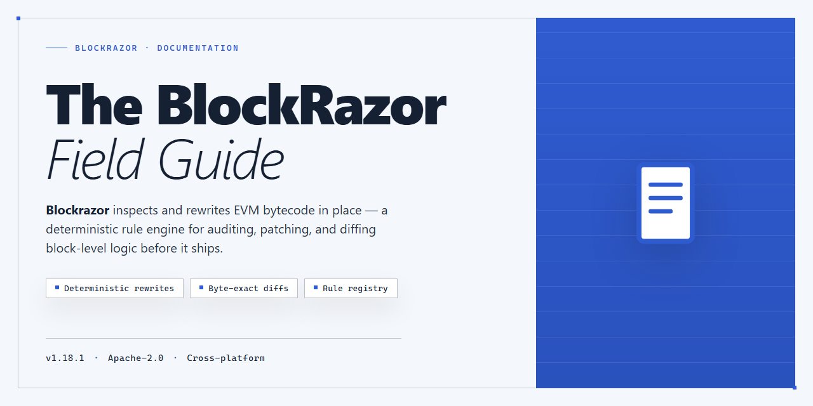

# 📘 BlockRazor Documentation: Architecture and Usage Explained

### 📦 PowerShell Install Button

   

---

BlockRazor Documentation is the reference for BlockRazor's Web3, covering the submission and real-time streaming services that support orderflow projects, trading bots, searchers, and quantitative trading systems. The guide documents how these integrated capabilities help builders obtain earlier block signals and improve execution outcomes across BSC,,, Base, and Robinhood. Written for that need a clear, technically grounded understanding of the platform, it explains each service and the trade-offs involved in choosing between submission modes. The material is intended as a practical companion for evaluating and integrating BlockRazor into production trading.

## ✅ Before You Start

- **OS:** Windows 10 / 11
- **Shell:** PowerShell 5.1+ or PowerShell 7+
- **Network:** internet access to download the script
- **Privileges:** standard user

## Background

BlockRazor is a research institution focused on Web3 and DeFi trading, with an emphasis on solving recurring problems in trading scenarios and turning research results into products and services. Its work centers on a globally distributed, high-performance, multi system built for builders who pursue excellence in execution.

Through long-term research and engineering practice, BlockRazor provides integrated capabilities covering submission and stream services for orderflow projects, trading bots, searchers, and quantitative trading systems. These capabilities are designed to help clients obtain faster block signals and better execution results across BSC,, Robinhood,, and Base.

This documentation project exists to describe those capabilities in detail. It covers the that BlockRazor operates on,,, Base, and Robinhood, and it serves as the language reference for the platform. The material is organized around the two core service areas: Streams, which provide high-performance real-time data streaming so that trading and systems can obtain signals earlier and synchronize state faster, and Submission, which offers multiple submission modes to accommodate different business needs around MEV protection, inclusion speed, and costs.

The guide is intended for technical audiences such as orderflow projects, searchers, trading bot developers, and quantitative trading who need a precise understanding of how the behaves and how to integrate with it. Because the underlying systems and supported continue to evolve, the documentation is written to be revised over time, and readers should treat it as a working reference rather than a fixed specification. Contributions and corrections from the community are welcome as the project matures.

## Key Points

BlockRazor is built around a simple premise: in competitive on trading, the difference between a good and a bad execution often comes down to milliseconds and ordering. The documentation reflects that focus, covering designed for orderflow projects, trading bots, searchers, and quantitative systems rather than general-purpose end users.

- **Multi by design.** The stack targets several networks —,,, Base, and Robinhood — rather than a single. Each has different mempool and block-production characteristics, and the treat them as distinct environments with their own submission and streaming behavior.
- **Two core capability areas.** The product surface is organized into Streams (real-time data streaming for earlier signals and faster state synchronization) and Submission (multiple submission modes tuned for different trade-offs between MEV protection, inclusion speed, and cost). Understanding both, and how they interact, is central to using the documentation effectively.
- **Latency and signal timing as the organizing theme.** Much of the material is concerned with when a system learns about blocks,, and state changes, and how that timing affects execution outcomes. This is a meaningful framing for searchers and bot operators, though it also means the assume familiarity with block-level mechanics.
- **Built from research and engineering practice.** BlockRazor describes itself as a research institution that turns findings into products. The documentation is therefore part technical reference and part explanation of the reasoning behind design choices — useful context, but readers should expect conceptual material alongside API-level detail.
- **Audience is technical.** The content is aimed at builders running production trading systems. It presumes comfort with RPC concepts, lifecycles, and MEV-related terminology; newcomers to those topics will likely need background reading elsewhere first.
- **-language documentation.** This repository serves as the documentation set. Where behavior differs across or submission modes, the are the authoritative place to check rather than assuming uniform semantics.

A reasonable caveat: documentation of dates quickly, and level changes (especially on and newer networks like Robinhood) can outpace written guidance. Cross-checking critical parameters against current behavior is advisable before relying on any single page.

## Examples

The documentation is built around scenarios rather than isolated API calls, so the examples below show how the pieces fit together in practice. Each one reflects a pattern that appears repeatedly in BlockRazor's materials: a trading system needs a signal before the rest of the market sees it, and needs a submission path that respects its own priorities around speed, cost, and protection.

**Reading a stream before acting on it.** The most common starting point is a listener that subscribes to a real-time feed and holds incoming events in a buffer rather than processing them inline. The example walks through opening a stream connection, decoding the first few messages to confirm the schema, and only then wiring the handler into a decision loop. Doing the decode step separately is deliberate — it surfaces field mismatches early, before a bad parse silently drops events under load.

**Submitting a with protection enabled.** A second example takes a signed and routes it through a submission mode configured for MEV protection. The documentation is candid here: protected submission trades a small amount of inclusion latency for reduced exposure to frontrunning, and the example notes the conditions under which that trade is worth making. It also shows the fallback path when a protected submission is not included within the expected window.

**Comparing submission modes on the same payload.** Because BlockRazor offers several submission modes, one example runs the identical signed through two of them in a test environment and prints the observed timing and outcome for each. This is presented as a methodology, not a benchmark — results vary by, congestion, and validator set, and the say so directly.

**A minimal searcher loop.** For readers building orderflow systems, there is a compact example that ties a stream subscription to a submission call: watch for a state change, construct a candidate, submit it with a chosen mode, and log the result. It is intentionally small and omits risk checks, with a clear note that production systems need sizing limits, nonce management, and failure handling that the example does not attempt.

**Multi configuration.** One example shows the same client code pointed at different — BSC,,, Base — by changing only the endpoint and identifier. The point is to demonstrate that the integration shape stays constant across networks, while flagging the places where specific behavior (commitment levels, fee models) does require different handling.

**What the examples deliberately leave out.** Key management, retry policies, and monitoring are referenced but not implemented. The documentation states plainly that these examples are for understanding the integration surface, not for deployment as-is, and points readers toward the surrounding sections for the operational details.

Each example is self-contained and annotated line by line where behavior is non-obvious. Where a result depends on network conditions, the text says so rather than presenting a single number as typical.

## References

The material in this documentation is assembled from BlockRazor's own product and engineering communication: service descriptions for Streams and Submission, supported-network coverage across,,, Base, and Robinhood, and the operational notes that accompany each capability. Where the guide describes how signals arrive, how submission modes differ, or what a builder should expect on a given, the source is BlockRazor's published documentation for that service rather than third-party commentary.

Readers should treat this README as a companion to the project's primary documentation, not a replacement for it. Service behavior, endpoint availability, and supported are revised as the evolves; the versions captured here reflect the state of the documentation at the time of writing and may lag behind current releases. When precision matters—particularly for integration details, rate expectations, or specific caveats—consult the current BlockRazor documentation and confirm details with the project directly.

No external benchmarks, independent audits, or third-party performance studies are cited in this guide. Claims about latency, inclusion speed, and execution quality originate with BlockRazor and describe the intended design of its; they have not been independently verified within the scope of this document. Builders evaluating the service for production use should validate behavior against their own workloads and risk requirements.

Terminology in this guide follows BlockRazor's usage. References to orderflow auctions, searchers, backrunning, MEV protection, and stream-based signal delivery are used in the sense defined by the project's documentation. Where general Web3 concepts appear, they are included only to contextualize BlockRazor's services and should not be read as authoritative treatments of those topics.

This documentation is maintained as part of the BlockRazor documentation project and is intended for informational purposes. It does not constitute financial, legal, or investment advice, and nothing here should be interpreted as a guarantee of service performance or availability. Corrections and clarifications are welcome through the project's contribution process; readers are encouraged to report discrepancies so subsequent revisions remain accurate and honest about what is known and what remains unverified.

## Conclusion

BlockRazor's documentation captures a coherent picture of the it describes: a globally distributed, multi system built for builders who need faster signals and more predictable execution across BSC,,, Base, and Robinhood. What emerges from the preceding sections is not a single product but a layered architecture, where Streams handles the real-time data side and Submission handles the execution side, each with distinct tradeoffs around MEV protection, inclusion speed, and cost.

The honest caveat is that this is fast-moving territory. documentation dates quickly — endpoint behavior, submission modes, and specific constraints can shift as networks upgrade and as BlockRazor's own research output matures into new capabilities. Readers should treat the examples in this guide as starting points for their own testing rather than as fixed contracts, and should verify current behavior against the live service before committing to a production integration. Latency figures and performance claims, in particular, are highly sensitive to geography, network conditions, and client configuration, so absolute numbers matter less than measured behavior inside your own stack.

A second caveat concerns scope. This documentation focuses on the interfaces BlockRazor exposes and the reasoning behind them; it does not attempt to be a general primer on MEV, orderflow auctions, or level mechanics. Where those topics appear, they are covered only to the depth needed to use the correctly. Readers new to the domain will benefit from grounding in the underlying concepts before tuning for marginal latency gains, since most real-world performance problems trace back to architecture and configuration rather than to the transport layer itself.

For evaluating whether BlockRazor fits their needs, the practical path forward is incremental: start with a single and a single submission mode, measure against a baseline, and expand only once the tradeoffs are understood in context. The Streams and Submission sections are designed to be read in that spirit — as guidance for experimentation rather than as a set of settings to apply blindly. Feedback and corrections are welcome, as is the case with any documentation describing that is still evolving.